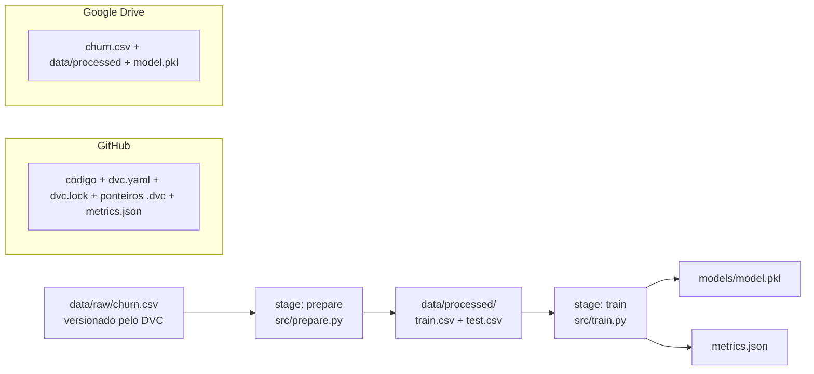

# End-to-End Churn Prediction com Git e DVC

Pipeline de Machine Learning **reprodutível, auditável e versionado** para prever *churn* (clientes que cancelam a assinatura) de um banco digital, construído com as práticas de MLOps: **Git** para código, **DVC** para dados, modelos e pipeline, e **Google Drive** como armazenamento remoto dos artefatos pesados.

> Projeto desenvolvido no estudo de caso do curso *MLOps Essentials Para Portfólio de Projetos – Gestão de Código e Dados com Git e DVC* (Data Science Academy).

---

## Sumário

1. [O problema](#1-o-problema)
2. [Por que Git + DVC](#2-por-que-git--dvc)
3. [Arquitetura](#3-arquitetura)
4. [Estrutura do repositório](#4-estrutura-do-repositório)
5. [Pré-requisitos](#5-pré-requisitos)
6. [Como reproduzir (passo a passo)](#6-como-reproduzir-passo-a-passo)
7. [O pipeline em detalhe](#7-o-pipeline-em-detalhe)
8. [Experimentos e métricas](#8-experimentos-e-métricas)
9. [Viagem no tempo (rollback)](#9-viagem-no-tempo-rollback)
10. [Padrão de commits](#10-padrão-de-commits)
11. [Problemas comuns no Windows](#11-problemas-comuns-no-windows)
12. [Limitações e próximos passos](#12-limitações-e-próximos-passos)

---

## 1. O problema

Um banco digital quer identificar quais clientes têm maior probabilidade de cancelar o serviço. A regra imposta pelo Tech Lead: **nada de notebooks isolados**. O projeto precisa ser:

| Requisito | O que significa na prática |
|---|---|
| **Reprodutível** | Qualquer pessoa clona o repositório e obtém exatamente o mesmo modelo e a mesma métrica. |
| **Auditável** | É possível responder: *"o modelo X foi gerado pelo commit Y do código com a versão Z dos dados"*. |
| **Versionado** | Código, dados, modelo e métricas evoluem juntos e podem voltar a qualquer versão anterior. |

## 2. Por que Git + DVC

Em software tradicional, o comportamento do sistema depende só do **código**. Em Machine Learning, depende de três pilares: **código + dados + parâmetros**. Se qualquer um muda sem registro, o modelo muda e ninguém sabe por quê.

O Git é excelente para texto, mas não foi feito para arquivos grandes (o GitHub limita arquivos a 100 MB e o histórico incha a cada versão de um CSV). Por isso usamos um **versionamento híbrido**:

| Ferramenta | Versiona | Onde fica |
|---|---|---|
| **Git** | Código (`.py`), configurações (`dvc.yaml`, `dvc.lock`), ponteiros (`.dvc`), `requirements.txt`, métricas | GitHub |
| **DVC** | Datasets (`.csv`), dados processados, modelos (`.pkl`) | Cache local (`.dvc/cache`) e remote (Google Drive) |

O DVC guarda o arquivo pesado fora do Git e deixa no repositório apenas um **ponteiro** com o hash MD5 do conteúdo:

```yaml
# data/raw/churn.csv.dvc
outs:
- md5: 7c35831cdae142e01de3ffcf26e716ea
  size: 678
  hash: md5
  path: churn.csv
```

O Git rastreia o ponteiro e o DVC rastreia o dado. Quando você volta para um commit antigo, o DVC sabe exatamente qual versão do dado restaurar.

## 3. Arquitetura



O fluxo de envio e recebimento acontece em duas camadas:

```text
Enviar:   git push  -> código e ponteiros para o GitHub
          dvc push  -> dados e modelos para o Google Drive

Receber:  git pull  -> código e ponteiros
          dvc pull  -> dados e modelos correspondentes àqueles ponteiros
```

## 4. Estrutura do repositório

```text
projeto-churn-dvc/
├── .dvc/
│   ├── config            # remote do DVC (Google Drive) — versionado
│   └── config.local      # credenciais OAuth — NÃO versionado
├── data/
│   ├── raw/
│   │   ├── churn.csv     # dado bruto (no DVC, ignorado pelo Git)
│   │   └── churn.csv.dvc # ponteiro (no Git)
│   └── processed/        # train.csv / test.csv (saída do stage prepare, no DVC)
├── models/
│   └── model.pkl         # modelo treinado (saída do stage train, no DVC)
├── src/
│   ├── prepare.py        # limpeza e divisão treino/teste
│   └── train.py          # treino do RandomForest e geração de métricas
├── dvc.yaml              # definição do pipeline (DAG)
├── dvc.lock              # hashes exatos de cada dependência e saída
├── metrics.json          # métricas do modelo atual
├── requirements.txt      # dependências com versões fixas
├── .gitignore
└── .dvcignore
```

**Dataset:** `churn.csv` com 27 clientes e as colunas `CustomerID`, `Tenure`, `MonthlyCharges`, `TotalCharges`, `NumServices` e `Churn` (alvo: 1 = cancelou, 0 = permaneceu).

## 5. Pré-requisitos

- **Python 3.11** (testado com 3.11.5)
- **Git** (no Windows, use o terminal **Git Bash**)
- Conta no **GitHub**
- Acesso à pasta do **Google Drive** usada como remote (veja a observação na seção 6.4)

Principais dependências (versões completas em `requirements.txt`):

| Pacote | Versão | Papel |
|---|---|---|
| `dvc` | 3.67.1 | Versionamento de dados e pipeline |
| `dvc-gdrive` | 3.0.1 | Suporte ao Google Drive como remote |
| `pandas` | 3.1.0 | Manipulação dos dados |
| `scikit-learn` | 1.9.1 | Divisão treino/teste e modelo |
| `pyOpenSSL` / `cryptography` | 24.2.1 / 43.0.3 | Par compatível exigido pelo PyDrive2 |

## 6. Como reproduzir (passo a passo)

### 6.1 Clonar o repositório

```bash
git clone https://github.com/jonathas12/projeto-churn-dvc.git
cd projeto-churn-dvc
```

### 6.2 Criar e ativar o ambiente virtual

```bash
python -m venv .venv
source .venv/Scripts/activate   # Windows (Git Bash)
# source .venv/bin/activate     # Linux / macOS
```

### 6.3 Instalar as dependências

```bash
pip install -r requirements.txt
dvc version   # deve listar "gdrive" em Supports
```

### 6.4 Baixar dados e modelos do remote

```bash
dvc pull
```

Este é o passo que diferencia um projeto com MLOps: sem ele o repositório tem apenas ponteiros, não os dados.

> **Sobre o acesso ao Google Drive:** o remote é uma pasta pessoal. Para usar o `dvc pull` você precisa ter acesso a ela e configurar um **OAuth Client ID próprio** (o Google bloqueia o client padrão do DVC com a mensagem *"Este app está bloqueado"*):
>
> 1. No [Google Cloud Console](https://console.cloud.google.com), crie um projeto e ative a **Google Drive API**.
> 2. Configure a **Tela de consentimento OAuth** (tipo *Externo*) e adicione o seu e-mail como **usuário de teste**.
> 3. Em **Credenciais**, crie um **ID do cliente OAuth** do tipo **App para computador**.
> 4. Registre as credenciais apenas localmente (`--local` grava em `.dvc/config.local`, que não vai para o Git):
>
> ```bash
> dvc remote modify myremote gdrive_client_id "SEU_CLIENT_ID" --local
> dvc remote modify myremote gdrive_client_secret "SEU_CLIENT_SECRET" --local
> ```
>
> Sem acesso ao Drive, aponte o DVC para o seu próprio armazenamento (`dvc remote add -d myremote gdrive://ID_DA_SUA_PASTA` ou um bucket S3/GCS/Azure) e coloque o seu `churn.csv` em `data/raw/` antes do próximo passo.

### 6.5 Reproduzir o pipeline

```bash
dvc repro
```

Se tudo veio do remote, o DVC responde `Data and pipelines are up to date.`, porque os hashes batem com o `dvc.lock`. Para provar a reprodutibilidade do zero, force a reexecução de todos os stages (sem `--force`, o DVC reaproveita o *run-cache* e apenas restaura as saídas):

```bash
dvc repro --force
git diff dvc.lock metrics.json   # vazio = resultado idêntico ao versionado
dvc metrics show
```

O `dvc.lock` gerado é idêntico ao versionado, com o mesmo hash MD5 para `data/processed` e `models/model.pkl`, porque `random_state=42` fixa a aleatoriedade da divisão e do modelo.

### 6.6 Conferir o estado

```bash
git status        # repositório limpo
dvc status        # Data and pipelines are up to date.
dvc status -c     # Cache and remote 'myremote' are in sync.
dvc dag           # desenha o grafo do pipeline
```

## 7. O pipeline em detalhe

O pipeline é declarado em `dvc.yaml`. Cada *stage* tem um comando (`cmd`), as dependências que disparam a reexecução (`deps`) e as saídas que o DVC versiona (`outs`):

```yaml
stages:
  prepare:
    cmd: python src/prepare.py
    deps:
      - data/raw/churn.csv
      - src/prepare.py
    outs:
      - data/processed

  train:
    cmd: python src/train.py
    deps:
      - data/processed
      - src/train.py
    outs:
      - models/model.pkl
    metrics:
      - metrics.json:
          cache: false   # métrica fica no Git para ser comparada entre commits
```

| Stage | Script | O que faz | Saída |
|---|---|---|---|
| `prepare` | `src/prepare.py` | Lê o CSV bruto, preenche valores ausentes com a mediana e divide 80/20 em treino/teste (`random_state=42`) | `data/processed/train.csv`, `data/processed/test.csv` |
| `train` | `src/train.py` | Treina um `RandomForestClassifier`, serializa o modelo e calcula a acurácia | `models/model.pkl`, `metrics.json` |

**Cache inteligente (memoização):** o `dvc repro` compara o hash de cada dependência com o registrado no `dvc.lock`.

- Mudou só `src/train.py` → o DVC pula `prepare` e roda apenas `train`.
- Mudou `data/raw/churn.csv` → o DVC roda `prepare` e `train`.
- Nada mudou → nenhum stage é executado.

## 8. Experimentos e métricas

| Commit | Experimento | `n_estimators` | Acurácia (treino) |
|---|---|---|---|
| `exp: altera n_estimators para 50` | Redução de árvores | 50 | 1.0 |
| Baseline (fase 3) | Configuração inicial | 100 | 1.0 |

Comandos para comparar:

```bash
dvc metrics show            # métrica do workspace atual
dvc metrics diff HEAD~1     # diferença em relação ao commit anterior
```

Ao executar o experimento, só o stage `train` foi reexecutado, o que confirma o cache por hash do DVC.

## 9. Viagem no tempo (rollback)

Cenário: o novo modelo performou pior em produção e é preciso voltar para a versão anterior.

```bash
git checkout HEAD~1   # restaura código e dvc.lock antigos
dvc checkout          # restaura dados processados e modelo correspondentes

git checkout main     # volta ao presente
dvc checkout
```

O `git checkout` traz os **ponteiros** antigos e o `dvc checkout` usa esses ponteiros para trazer os **arquivos** antigos do cache.

## 10. Padrão de commits

O histórico segue **Commits Semânticos** (*Conventional Commits*): `<tipo>: <descrição>`.

| Tipo | Uso | Exemplo neste projeto |
|---|---|---|
| `feat` | Nova funcionalidade | `feat: versiona churn.csv com DVC e configura remote gdrive` |
| `fix` | Correção de bug | `fix: adiciona prepare.py e gitignores ausentes no versionamento` |
| `docs` | Documentação | `docs: adiciona README com guia de reprodutibilidade` |
| `chore` | Manutenção / setup | `chore: inicializa projeto com DVC` |
| `exp` | Experimento de modelagem | `exp: altera n_estimators para 50` |
| `data` | Alteração de dados | `data: adiciona dataset bruto de churn versionado pelo DVC` |

## 11. Problemas comuns no Windows

| Sintoma | Causa | Solução |
|---|---|---|
| `bash: dvc: command not found` | Ambiente virtual não ativado naquele terminal | `source .venv/Scripts/activate` |
| `mkdir -p a b` falha no PowerShell | Sintaxe Bash no PowerShell | Use o **Git Bash** ou `mkdir a, b` |
| `ERROR: '.dvc' exists` no `dvc init` | O projeto já foi inicializado | Não é erro; não rode `dvc init` novamente |
| `dvc push` → `Everything is up to date` sem enviar nada | Nenhum arquivo rastreado com `dvc add` | `dvc add <arquivo>` antes do push |
| `module 'lib' has no attribute 'GEN_EMAIL'` | `pyOpenSSL` antigo com `cryptography` novo | `pip install "pyOpenSSL==24.2.1" "cryptography<44"` |
| *"Este app está bloqueado"* no login do Google | Client OAuth padrão do DVC bloqueado | Criar Client ID próprio (seção 6.4) |
| `pip install -r requirements.txt` falha com caracteres estranhos | Arquivo gerado no PowerShell em UTF-16 | Gerar com `pip freeze > requirements.txt` no Git Bash |
| `git add` avisa que `churn.csv` é ignorado | Comportamento esperado do DVC | Adicione o ponteiro: `git add data/raw/churn.csv.dvc` |

## 12. Limitações e próximos passos

**Limitações conhecidas (intencionais no escopo didático):**

- A acurácia é calculada **sobre os próprios dados de treino**, por isso o valor é 1.0. Ela comprova o funcionamento do pipeline, não a capacidade de generalização do modelo.
- O dataset tem 27 linhas e a coluna `CustomerID` entra como variável preditora.

**Próximos passos:**

1. Criar o stage `evaluate` medindo acurácia, precisão, recall e F1 em `test.csv`.
2. Remover `CustomerID` das features.
3. Centralizar hiperparâmetros em `params.yaml` e usar `dvc exp run` para experimentos.
4. Adicionar CI/CD com GitHub Actions (e CML) para rodar `dvc repro` a cada pull request.
5. Migrar o remote para um bucket em nuvem (S3, GCS ou Azure Blob) com acesso de equipe.

---

**Autor:** Jonathas Gomes Marques · [github.com/jonathas12](https://github.com/jonathas12)

**Referências:** [Git](https://git-scm.com/docs) · [GitHub Docs](https://docs.github.com/en) · [DVC](https://doc.dvc.org) · [Conventional Commits](https://www.conventionalcommits.org/pt-br/)
